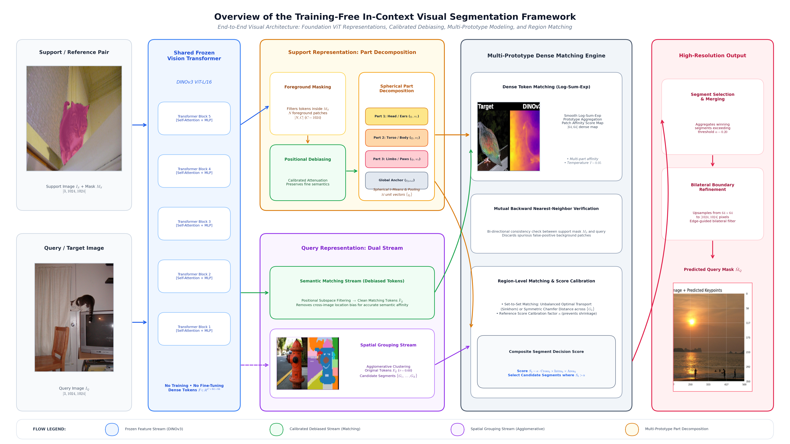
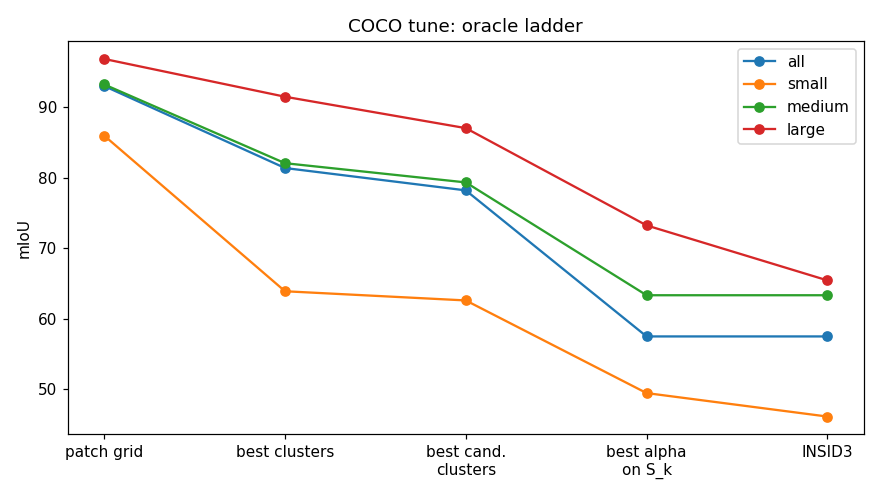
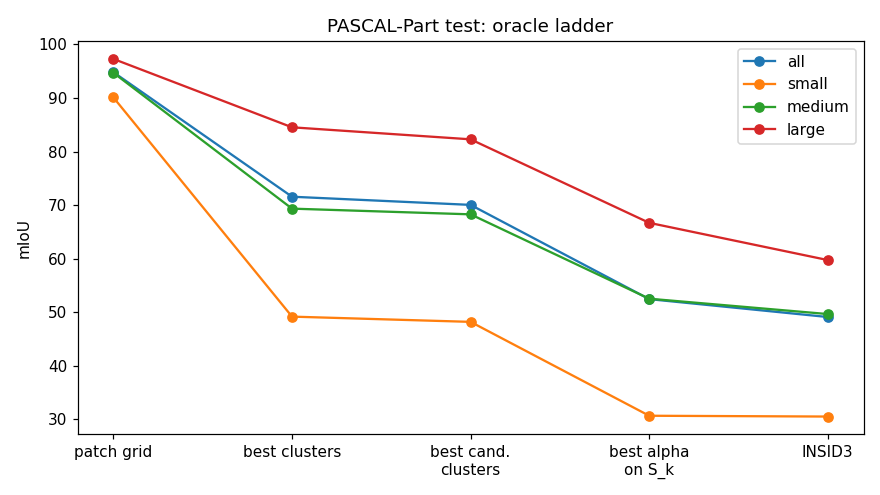
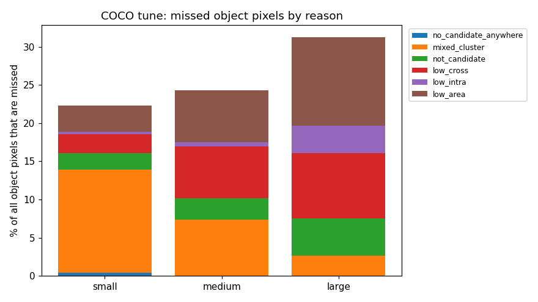
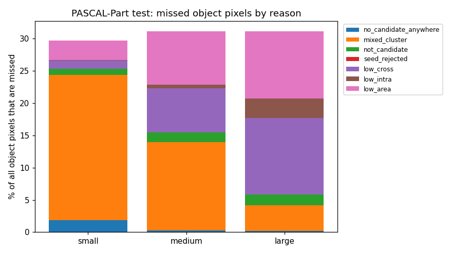
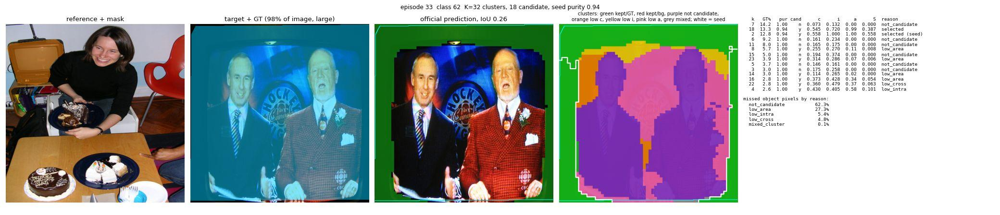
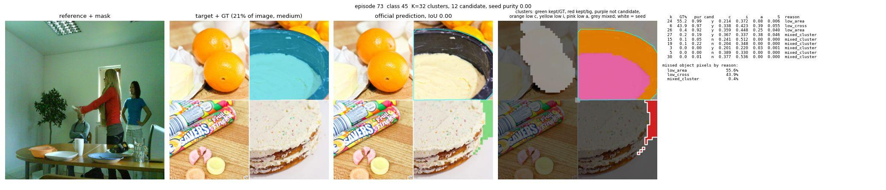

# In-Context Visual Segmentation & Foundation Model Representations: An Empirical and Diagnostic Study

[](https://www.python.org/)
[](https://pytorch.org/)
[](tests/)
[](LICENSE)
[](results/)

An independent computer vision research investigation into **training-free in-context visual segmentation** with frozen vision foundation models (DINOv3/DINOv2). 

This project explores the mechanics of zero-shot in-context object transfer, investigates adaptive feature debiasing and multi-prototype part representations, and conducts an **exhaustive, pixel-level diagnostic study** that uncovers the exact mathematical bottlenecks in state-of-the-art training-free segmentation pipelines.

---

## 📌 Executive Summary & Research Journey

```
┌─────────────────────────┐     ┌─────────────────────────┐     ┌─────────────────────────┐
│ 1. Paper Deconstruction │ ──> │ 2. Hypothesis Building  │ ──> │ 3. Empirical Testing    │
│    INSID3 (CVPR 2026)   │     │    • Spectral Debiasing │     │    Paired Bootstrap CIs │
│    In-Context Matching  │     │    • Multi-Prototype OT │     │    Statistical Testing  │
└─────────────────────────┘     └─────────────────────────┘     └─────────────────────────┘
                                                                             │
                                                                             ▼
┌─────────────────────────┐     ┌─────────────────────────┐     ┌─────────────────────────┐
│ 6. Actionable Takeaways │ <── │ 5. Discovery of Causes  │ <── │ 4. Deep Root Diagnosis  │
│    Dynamic Thresholding │     │    Large: Fixed Alpha   │     │    Oracle Ladder        │
│    Adaptive Clustering  │     │    Small: Cluster Purity│     │    Attribution Taxonomy │
└─────────────────────────┘     └─────────────────────────┘     └─────────────────────────┘
```

1. **The Starting Point (Paper Deconstruction):**  
   Modern vision foundation models (e.g., DINOv3 ViT-L/16) encode rich spatial semantics without task-specific fine-tuning. INSID3 (CVPR 2026) leverages frozen patch tokens to perform few-shot segmentation by combining reference similarity ($c_k$), seed similarity ($i_k$), and candidate density ($a_k$). My goal was to understand where and why this paradigm breaks down on complex visual scenes.

2. **Developing Hypotheses & Extensions:**  
   - **Hypothesis 1 (Positional Bias):** ViT self-attention retains spurious positional energy. The baseline removes this via a rigid 500-rank SVD projection that strips 57% of feature energy indiscriminately. I designed a **generalized parametric attenuation framework (Spectral Wiener Filtering & Calibrated MMSE)** to preserve semantic fidelity while suppressing positional correlation.
   - **Hypothesis 2 (Prototype Expressiveness):** A single global average token cannot represent multi-part, articulated objects (e.g., animals with distinct heads, torsos, and limbs). I developed an **unsupervised part-level decomposition** using spherical clustering paired with **Symmetric Chamfer Distance** and **Unbalanced Optimal Transport (Sinkhorn)** matching.

3. **Empirical Evaluation & Scientific Honesty:**  
   Evaluating across 1,000 paired episodes on COCO and benchmarks on PASCAL-Part and SPair-71k, spectral attenuation achieved statistically significant gains on keypoint correspondence (+2.42% PCK@0.10, $p < 10^{-10}$) and marginal tuning improvements (+0.44% mIoU, $p = 0.04$). However, critical evaluation across out-of-distribution test sets revealed that neither extension resolved the persistent under-segmentation of complex objects.

4. **The Diagnostic Breakthrough (Root-Cause Investigation):**  
   Rather than stacking more heuristics, I paused model modifications to perform a **first-principles mathematical diagnosis**. I built an instrumentation engine that verified bit-for-bit equivalence against the baseline and constructed:
   - An **Oracle Ladder** bounding the upper limit of patch grids, spatial clusters, candidate filtering, and score thresholds.
   - A **100% mutually exclusive pixel-level attribution taxonomy** tracking the exact fate of every missed ground-truth pixel across object scales.

5. **The Definitive Findings:**  
   - **Large Objects:** The bottleneck is **neither prototype diversity nor spatial clustering**. Within each episode, the composite score $S_k$ discriminates foreground from background remarkably well (**AUC = 0.93**). The true failure is a **rigid global merge threshold ($\alpha = 0.2$)** applied across episodes whose score scales shift dynamically.
   - **Small Objects:** The bottleneck is **spatial agglomerative clustering granularity ($\tau = 0.6$)**, where small target objects are absorbed into predominantly background clusters (`mixed_cluster` accounts for 60–78% of missed pixels).

---

## 🏛️ System Architecture

Below is the end-to-end architecture of the training-free in-context visual segmentation pipeline, detailing the frozen vision backbone, calibrated debiasing stream, multi-prototype decomposition, and candidate merge logic:



---

## 🔬 Research Modules & Methodology

### Module 1: Adaptive Positional Debiasing

Vision Transformer patch embeddings $\mathbf{x} \in \mathbb{R}^C$ from self-supervised backbones exhibit high positional correlation across scenes. The official baseline performs a hard projection onto the orthogonal complement of the top $s=500$ principal components:
$$\tilde{\mathbf{x}} = \text{normalize}\left(\left(\mathbf{I} - \mathbf{U}_{:s} \mathbf{U}_{:s}^\top\right)\mathbf{x}\right)$$

While effective at removing background center-bias, hard truncation indiscriminately removes 57.4% of total feature energy. I generalized this into a continuous parametric attenuation framework:
$$\tilde{\mathbf{x}} = \text{normalize}\left(\mathbf{x} - \mathbf{U} \left(\boldsymbol{\lambda} \odot \mathbf{U}^\top \mathbf{x}\right)\right)$$

Where $\boldsymbol{\lambda} \in [0, 1]^K$ is an attenuation vector:
- **Spectral Wiener Filter:** $\lambda_k = \frac{1}{1 + (k / k_0)^\gamma}$, providing smooth high-frequency retention with cutoff $k_0$ and steepness $\gamma$.
- **Calibrated MMSE Gain:** $\lambda_k = \text{clamp}(\beta \cdot \rho_k, 0, 1)$, where $\rho_k$ is the empirical correlation between the $k$-th principal component and absolute spatial coordinates.

```
Hard Truncation:      [ 1  1  1  1  1  0  0  0  0  0 ... 0 ]  (Discontinuous cut)
Spectral Attenuation: [ 1.0  0.98  0.92  0.81  0.64 ... 0 ]  (Smooth Wiener curve)
```

---

### Module 2: Part-Level Decomposition & Optimal Transport Matching

To address the limitations of compressing an entire reference mask into a single mean prototype vector $\mathbf{p} = \frac{1}{|\mathcal{M}_r|} \sum_{i \in \mathcal{M}_r} \mathbf{x}_i$, I developed an unsupervised sub-object representation:

1. **Unsupervised Part Discovery:** Support tokens within the ground-truth mask $\mathcal{M}_r$ are clustered into $M$ localized prototypes $\mathcal{P} = \{(\mathbf{q}_j, w_j)\}_{j=1}^M$ using Spherical $k$-Means with cosine affinity:
   $$M_{\text{eff}} = \max\left(1, \min\left(M, \left\lfloor \frac{|\mathcal{M}_r|}{N_{\min}} \right\rfloor\right)\right)$$
2. **Many-to-Many Region Matching:** For any target cluster $G_k$, similarity against the prototype set $\mathcal{P}$ is scored via:
   - **Log-Sum-Exp Soft Maximum:** $a_i = T \cdot \log \sum_{j=1}^M w_j \exp(s_{ij} / T)$
   - **Symmetric Chamfer Distance:** $r_k = \frac{1}{2} \left[ \frac{1}{|G_k|} \sum_{i \in G_k} \max_j s_{ij} + \sum_{j=1}^M w_j \max_{i \in G_k} s_{ij} \right]$
   - **Unbalanced Optimal Transport:** Solved via entropic Sinkhorn iterations relaxing marginal constraints with KL divergence to prevent penalizing target parts absent in the reference view.

---

### Module 3: Bit-for-Bit Diagnostic Engine & Oracle Ladder

To rigorously diagnose the pipeline without introducing confounding factors, I built a zero-drift diagnostic testbed that hooks into internal representations during evaluation.

#### The Oracle Ladder
The Oracle Ladder isolates each decision step by replacing it with a ground-truth-optimal oracle:
1. **Patch Grid Limit (`ub_patch`):** Upsampling ceiling using 16px patch cells.
2. **Cluster Purity Upper Bound (`ub_clusters_all`):** Best achievable segmentation using INSID3's agglomerative clusters.
3. **Candidate Filter Upper Bound (`ub_clusters_candidates`):** Best achievable segmentation using only clusters passing forward/backward nearest-neighbor matching.
4. **Optimal Global Threshold (`ub_best_alpha`):** Performance when $\alpha$ is tuned globally per dataset.
5. **Actual INSID3:** The production baseline score $S_k = c_k \cdot i_k \cdot a_k > 0.2$.

| Oracle Ladder (COCO Tuning Split) | Oracle Ladder (PASCAL-Part Test Split) |
|:---:|:---:|
|  |  |

#### Mutually Exclusive Pixel Attribution
Every missed ground-truth pixel is mapped to exactly one root cause:
- `mixed_cluster`: The pixel lies in a cluster where object purity $<50\%$ (spatial clustering failure).
- `not_candidate`: The cluster has 0 patches satisfying bidirectional matching.
- `low_cross`: Cluster rejected because prototype similarity $c_k$ is the bottleneck factor.
- `low_intra`: Cluster rejected because seed similarity $i_k$ is the bottleneck factor.
- `low_area`: Cluster rejected because candidate density $a_k$ is the bottleneck factor.

| False Negative Attribution (COCO Tuning) | False Negative Attribution (PASCAL-Part Test) |
|:---:|:---:|
|  |  |

---

## 📊 Experimental Results

### 1. Feature Representation & Debiasing Analysis (COCO Tuning Split)

Evaluated across 1,000 paired episodes on frozen DINOv3 ViT-L/16 ($1024 \times 1024$ resolution). Paired bootstrap statistics computed with $B=10,000$ resamples:

| Method / Configuration | Description | mIoU (%) | $\Delta$ vs Baseline | 95% Confidence Interval | $p$-value |
|---|---|:---:|:---:|:---:|:---:|
| **Raw Features (`none`)** | No debiasing ($s=0$) | 53.13% | $-4.34\%$ | $[-5.91, -2.81]$ | $0.000$ |
| **Baseline (Official)** | Hard SVD Truncation ($s=500$) | 57.48% | $0.00\%$ | — | — |
| **Calibrated MMSE ($\beta=1.0$)** | Coordinate-correlated attenuation | 56.87% | $-0.61\%$ | $[-1.77, +0.40]$ | $0.216$ |
| **Token-LS Template** | Spatial template regression | 57.06% | $-0.41\%$ | $[-1.53, +0.68]$ | $0.460$ |
| **Wiener Spectral ($\gamma=1$)** | Linear Wiener roll-off | 57.84% | $+0.37\%$ | $[-0.22, +1.06]$ | $0.204$ |
| **Wiener Spectral ($\gamma=4$)** ⭐ | **Steep polynomial roll-off** | **57.92%** | $\mathbf{+0.44\%}$ | $[\mathbf{+0.02}, \mathbf{+1.02}]$ | $\mathbf{0.040}$ |

*Key Result:* On fine-grained keypoint correspondence (SPair-71k benchmark, 12,234 pairs), Wiener Spectral debiasing improved PCK@0.10 from **69.87% to 72.29% (+2.42%, $p < 10^{-10}$)** over the official baseline, proving that soft attenuation preserves localized high-frequency semantics.

---

### 2. Full Diagnostic Benchmark Across All Datasets

Comprehensive evaluation across COCO-20i (4 folds, 4,000 episodes), PASCAL-Part (4 folds, 10,000 episodes), and PASCAL-Part 5-shot (2,500 episodes):

| Dataset / Split | Episodes | Verify Mismatches | Official Baseline | Oracle Clusters | Oracle Candidates | Threshold Ceiling ($\alpha^*$) |
|---|:---:|:---:|:---:|:---:|:---:|:---:|
| **COCO Tune** | 1,000 | **0** | **57.48%** | 81.40% | 78.22% | 69.56% |
| **COCO-20i Test** | 4,000 | **0** | **56.24%** | 75.54% | 72.80% | 57.26% |
| **PASCAL-Part Test** | 10,000 | **0** | **49.12%** | 76.15% | 74.02% | 56.45% |
| **PASCAL-Part 5-Shot** | 2,500 | **0** | **66.98%** | 88.00% | 87.05% | 73.34% |

---

### 3. Root Cause Breakdown by Object Scale

The diagnostic investigation demonstrated that visual in-context segmentation exhibits fundamentally different failure modes depending on object scale:

```
┌─────────────────────────────────────────────────────────────────────────────────┐
│                           OBJECT SIZE DICHOTOMY                                 │
├──────────────────────────────────────┬──────────────────────────────────────────┤
│ SMALL OBJECTS (< 5% image area)      │ LARGE OBJECTS (> 25% image area)         │
├──────────────────────────────────────┼──────────────────────────────────────────┤
│ • Primary Failure: CLUSTERING        │ • Primary Failure: MERGE THRESHOLD       │
│ • 60%–78% missed pixels: mixed_cluster│ • < 9% missed pixels: mixed_cluster      │
│ • Spatial granularity gap: 22–41 mIoU│ • Ranking AUC within episode: 0.93       │
│ • Problem: Patches merged with BG    │ • Problem: Rigid α = 0.2 across scenes   │
└──────────────────────────────────────┴──────────────────────────────────────────┘
```

#### Detailed Scale Attribution Table (COCO Tune Split)
| Object Size Scope | Missed Pixel Share | Dominant Loss Reason | Primary Oracle Gap | Ranking AUC ($S_k$) |
|---|:---:|---|---|:---:|
| **Small Objects ($<5\%$)** | 22.3% | `mixed_cluster` (60.6%) | Clustering Granularity (22.10 mIoU) | 0.931 |
| **Medium Objects ($5\text{--}25\%$)** | 24.3% | `mixed_cluster` (30.2%) / `low_area` (27.8%) | Ranking by $S_k$ (16.03 mIoU) | 0.934 |
| **Large Objects ($>25\%$)** | 31.3% | `low_area` (37.1%) / `low_cross` (27.2%) | Ranking / Threshold (13.81 mIoU) | 0.932 |

---

## 🔍 Qualitative Case Studies & Failure Visualizations

To verify the mathematical findings, representative failure episodes were extracted and mapped across reference, target, prediction, cluster status, and factor tables:

### Case Study 1: Large Object Failure — Rigid Threshold Rejection



*Detailed Breakdown (Episode 33, Large Object):*
- **Panel 1:** Support reference image with ground truth outline.
- **Panel 2:** Query target image with cyan ground truth mask (97.7% of image area).
- **Panel 3:** Official baseline prediction showing severe under-segmentation (IoU = 0.26).
- **Panel 4:** Cluster status map. The seed cluster ($k=2$) is accepted (**green**, $S_k = 0.558 > 0.2$). Multiple large contiguous object body parts are rejected because they have 0 candidate patches (**purple** `not_candidate`, $k=0, 3, 5, 6, 7, 11, 15$), and several other valid segments are rejected due to low candidate patch shares (**pink** `low_area`, $k=1, 8, 10, 16, 23$).
- **Panel 5 (Factor Table):** Shows that although clusters possess $>90\%$ object purity, partial candidate support ($a_k \in [0.01, 0.34]$) depresses the product $S_k = c_k \cdot i_k \cdot a_k$ to $0.05\text{--}0.10$. Despite being true object parts, they fall beneath the rigid threshold $\alpha = 0.2$.

---

### Case Study 2: Medium Object Failure — False Background Seed



*Detailed Breakdown (Episode 73, Medium Object):*
- **Panel 1 & 2:** Reference pair and target image.
- **Panel 3:** Baseline prediction yields IoU = 0.00 (complete foreground miss).
- **Panel 4 & 5:** An erroneous background cluster ($k=7$, purity $0.00$) is selected as the seed (**red**, $S_k = 0.354$), anchoring intra-image propagation to the background. True foreground clusters ($k=6, 24, 26$, purity $>0.92$) are rejected due to prototype mismatch (**orange** `low_cross`, $c=0.34$) and partial overlap (**pink** `low_area`).

---

## 💡 Key Research Insights & Engineering Takeaways

1. **The Fallacy of Intuition in Foundation Models:**  
   It was intuitive to assume that complex, articulated objects require multi-prototype representation. However, the diagnostic data revealed that $c_k$ alone already separates foreground from background with **AUC 0.91–0.92**. The limitation was never representation capacity—it was decision calibration.

2. **The Danger of Score Multiplication Without Calibration:**  
   INSID3 computes $S_k = c_k \cdot i_k \cdot a_k$. Because each factor is bounded in $[0, 1]$, if all three factors are moderately strong ($c \approx 0.38, i \approx 0.50, a \approx 0.45$), their product sinks to $S_k \approx 0.085$, well below $\alpha = 0.2$. A fixed threshold creates extreme recall fragility on large objects.

3. **Scale-Dependent Architectural Separation:**  
   A single pipeline cannot simultaneously address small and large objects:
   - Small objects require multi-scale or hierarchical clustering ($\tau < 0.6$) and CRF boundary refinement to prevent background contamination.
   - Large objects require **dynamic, scene-adaptive thresholding** (e.g., calibrating $\alpha$ based on candidate score quantiles within each scene).

---

## 🛠️ Repository Structure

```
├── assets/                       # High-resolution architectural diagrams & qualitative plots
├── configs/                      # Configuration files (baseline, spectral, multi-prototype)
├── docs/                         # In-depth technical guides & diagnostic protocols
│   ├── 8_diagnosis.md            # Pre-registered diagnostic rules & ontology
│   └── EXPERIMENTAL_PROTOCOL.md  # RNG isolation, split definitions, metrics
├── insid3_ext/                   # Research extensions & diagnostic modules
│   ├── calibration.py            # SVD basis extraction & MMSE coordinate correlation
│   ├── debiasing.py              # Parametric Wiener & adaptive debiasing filters
│   ├── diagnosis.py              # Zero-drift diagnostic hooks & attribution engine
│   ├── matching.py               # Optimal Transport (Sinkhorn) & Chamfer distance
│   └── prototypes.py             # Spherical k-Means part decomposition
├── models/                       # Upstream INSID3 model definitions (unmodified)
├── scripts/                      # Evaluation & analysis scripts
│   ├── diagnose_segmentation.py  # CLI diagnostic evaluation runner
│   ├── analyze_diagnosis.py      # Post-processing & report generation
│   └── verify_upstream.py        # SHA256 integrity verification
├── tests/                        # Full test suite (218 unit/integration tests)
│   ├── test_diagnosis.py         # Invariant & mathematical property tests
│   └── test_baseline_equivalence.py # Bit-for-bit regression guarantees
└── run_diagnosis.sh              # Resumable multi-stage execution pipeline
```

---

## 🚀 Reproduction & Verification

### 1. Verification of Code Integrity & Invariants

```bash
# Verify upstream code matches visinf/INSID3@0c165a1 exactly (40/40 SHA256 hashes)
python scripts/verify_upstream.py

# Run complete test suite (218 passed)
pytest tests/ -q
```

### 2. Executing Diagnostic Experiments

The diagnostic pipeline is fully modular and resumable:

```bash
# Smoke test (5 episodes + baseline equivalence)
STAGE=check ./run_diagnosis.sh

# Run COCO tuning diagnosis (1,000 episodes)
STAGE=coco_tune ./run_diagnosis.sh

# Run PASCAL-Part benchmark (4 folds, 10,000 episodes)
STAGE=pascal ./run_diagnosis.sh

# Run COCO-20i benchmark (4 folds, 4,000 episodes)
STAGE=coco_test ./run_diagnosis.sh

# Generate markdown report, summary tables, and figures
STAGE=report ./run_diagnosis.sh
```

---

## 👤 Author & Acknowledgments

* **Independent Research & Implementation:** Vanshika Gupta
* Baseline foundation based on *INSID3: Training-Free In-Context Segmentation with DINOv3* (Cuttano et al., CVPR 2026).
* All experimental evaluations and diagnostic analyses were conducted with frozen backbones under deterministic seed isolation.
